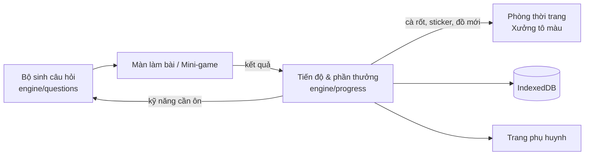

# 03 — Kịch bản làm website "Toán Rốt"

> "Toán Rốt" là tên tạm lấy theo tên repo, linh vật là **Thỏ Rốt** (chú thỏ hồng mê cà rốt). Bạn có thể đổi tên tuỳ ý — chỉ cần sửa trong `AGENTS.md`.
>
> Tài liệu gồm 2 phần lớn: **kịch bản sản phẩm** (cháu sẽ trải nghiệm gì) và **kịch bản thi công** (từng bước, kèm câu lệnh dán cho AI như Antigravity hoặc Claude Code).

---

## ⚡ Lộ trình nhanh: ôn thi giữa học kì 1 (đã làm — 26/10/2026)

Cháu học **Kết nối tri thức**, đã học xong **Bài 22** (hết Chủ đề 3) và sắp thi giữa kì 1. Vì vậy thứ tự thi công được đổi: làm ngay một bản chạy được để ôn **Bài 1–22**, rồi mới quay lại các giai đoạn bên dưới.

**Đã có trong repo** (chạy bằng `npm install` rồi `npm run dev`):

| Phần | Nội dung | Tương ứng giai đoạn |
|---|---|---|
| Khung web + giao diện dễ thương | Vite + React + TypeScript, Tailwind + daisyUI theme pastel, font Baloo 2 / Nunito, nút đọc to giọng Việt, âm thanh Web Audio, pháo giấy | GĐ1 |
| Bộ sinh câu hỏi Bài 1–22 | 23 dạng bài (số đến 1 000, cộng trừ có nhớ ≤ 1 lượt, lời văn thêm/bớt/nhiều hơn/ít hơn, tìm thành phần, bảng nhân chia 2–9, **xem đồng hồ, đổi cm–dm–m–km, kg, lít, đường gấp khúc (Bài 7)**, một phần mấy (hình và nhóm đồ vật khoanh), lời văn nhân chia có ngữ cảnh tiệm may, trung điểm (cả trên tam giác lưới ô vuông), hình tròn (có dây cung), **kiến bò qua các hình tròn, hình tròn xếp vừa khít trong hình chữ nhật, đếm hình, ghép khối lập phương và sơn mặt** (như vở bài tập), góc vuông, hình phẳng, khối lập phương/hộp/trụ/cầu), hình minh hoạ SVG kiểu SGK, đáp án nhiễu theo lỗi sai thật, **hơn 120 test tự động** | GĐ2 (CD01–CD03) |
| Ôn thi giữa kì | 10 trạm ôn theo bài (có trạm 🧩 Thử thách hình vẽ) + **đề thi thử 15 câu** (không gợi ý) + màn kết quả chỉ ra phần cần ôn | GĐ3 |
| Tiến độ và thưởng | Lưu trên máy (IndexedDB), điểm thành thạo từng kỹ năng, gợi ý 3 bậc, cà rốt, sao, hỏi lại câu sai | GĐ3 |
| Tủ đồ Thỏ Rốt | 28 món trong 8 ngăn (trên đầu, kính, cổ, váy áo, giày, cầm tay, sau lưng, phông nền); **bé tự đổi màu** đồ; 5 **đồ đặc biệt** chỉ mở khoá bằng thành tích (3 sao ở 3 trạm, 3 sao đề thi thử, trình diễn, tô 3 tranh, học 3 ngày) | GĐ4 (bản rút gọn) |
| Sàn diễn thời trang | 8 câu trộn (ưu tiên dạng bé còn yếu); mỗi câu xong Thỏ Rốt bước một bước trên sàn, đúng ngay lần đầu được đèn flash 📸; cuối buổi có poster "Người mẫu nhí" | GĐ4 (sàn diễn) |
| Mini-game Phaser 4 | 4 trò: **Hứng kẹo**, **Bắn bóng bay** (5 chủ đề: bảng nhân 2–5, 6–9, bảng chia, tìm số chưa biết, cộng trừ nhẩm tròn chục), **Lật thẻ ghép đôi** (phép nhân, phép chia, đồng hồ ↔ giờ), **Tiệm bánh chia đều** (kéo bánh vào hộp). Phaser chỉ hiển thị; đề từ `src/engine/questions/games.ts`, chấm điểm và thưởng ở React. Không thua cuộc, có tạm dừng; Phaser tải riêng khi vào chơi | GĐ6 (4 trò đầu) |
| Nhiệm vụ hằng ngày, vườn hoa | 3 nhiệm vụ mỗi ngày (làm bài, hoàn thành trạm, sáng tạo) × 🥕 5, xong cả 3 mở hộp quà; mỗi ngày học nở một bông hoa, nghỉ không làm héo vườn | GĐ3 (vòng lặp thưởng) |
| Xưởng Tô Màu | 3 tranh bí mật (bánh kem, váy công chúa, kem ốc quế) × 4 loại phép tính, tô tự do, bộ sưu tập | GĐ5 (chưa có vẽ tay) |
| Trang bố mẹ | Bảng tiến độ theo chủ đề, "nên ôn thêm", trang **Xem trước câu hỏi** có đáp án | GĐ10 (một phần) |

**Chưa làm** (theo đúng các giai đoạn bên dưới): các mini-game còn lại của GĐ6 (thỏ nhảy tia số, cân đĩa, túi mù… — chờ các chủ đề tương ứng), các chủ đề sau giữa kì (GĐ7–8, mở dần theo lớp), bản đồ 2.5D (GĐ9), vẽ tay tự do, chạy offline (PWA). Khi làm tiếp, chỉ cần **thêm bộ sinh câu hỏi cho chủ đề mới** vào `src/engine/questions/` và một trạm vào `src/features/onthi/stations.ts`.

---

# PHẦN 1 — KỊCH BẢN SẢN PHẨM

## 1.1. Ý tưởng trong một câu

> **Cháu là nhà thiết kế thời trang nhí ở Thị trấn Cà Rốt.** Mỗi bài toán giải được giúp tiệm của cháu lớn lên: thêm màu để tô, thêm vải để may, thêm váy đẹp cho nhân vật — và cuối mỗi học kì là một **buổi trình diễn thời trang**.

Toán không phải "bài kiểm tra" mà là **công cụ để làm điều cháu thích**: tô màu, vẽ, thay đồ, trang trí.

## 1.2. Nhân vật

| Nhân vật | Vai trò |
|---|---|
| **Nhân vật của cháu** | Cháu tự tạo (tóc, màu da, váy), tự đặt tên. Biểu cảm thay đổi khi làm bài |
| 🐰 **Thỏ Rốt** | Bạn đồng hành: đọc đề, khen, gợi ý, nhắc giờ nghỉ |
| 🐱 **Cô Mèo Bông** | Chủ Tiệm May Đo — dạy hình học, đo lường, chu vi, diện tích |
| 🐻 **Bác Gấu Bánh** | Chủ Tiệm Bánh — dạy nhân, chia, "một phần mấy" |
| 🦉 **Chị Cú Đồng Hồ** | Giữ Tháp Đồng Hồ — dạy xem giờ, lịch, số La Mã |
| 🐷 **Heo Hồng** | Ngân hàng — dạy tiền Việt Nam, số lớn, làm tròn |
| 🦊🐼🐨 **Các bạn khách** | Đặt "đơn hàng" — mỗi đơn là một bài toán có lời văn |

## 1.3. Lần đầu vào trang (3 phút đầu quyết định cháu có thích không)

1. **Thỏ Rốt nhảy ra chào**, hỏi tên cháu (gõ tên hoặc chọn sẵn).
2. **Tạo nhân vật**: chọn kiểu tóc, màu tóc, chiếc váy đầu tiên — miễn phí, không có câu hỏi nào.
3. **Tô màu tấm biển "Tiệm của [tên cháu]"**: 4 phép tính rất dễ (bảng nhân 2, 5) → mỗi câu đúng tô một vùng → tấm biển hiện ra lấp lánh. *Trải nghiệm đầu tiên là thứ cháu thích nhất: tô màu.*
4. Nhận **50 cà rốt** 🥕 và mở **bản đồ thị trấn**. Thỏ Rốt: "Mình đi mua chiếc nơ đầu tiên nhé!"

## 1.4. Bản đồ Thị trấn Cà Rốt (2.5D)

Bản đồ nhìn nghiêng kiểu isometric, các toà nhà dễ thương, mây trôi, khói bếp bay. Khu chưa mở có ổ khoá và số ⭐ cần có. Thứ tự mở khoá **đi theo sách** (chi tiết trong `docs/01-chuong-trinh-toan-3.md`, mục 5):

| Khu | Kiến thức | Mở khi |
|---|---|---|
| 🏠 Phòng của bé | thay đồ, tủ đồ, bộ sưu tập tranh, sổ sticker | từ đầu |
| 🎨 Xưởng Tô Màu | luyện mọi phép tính bằng tô màu bí mật; vẽ tự do | từ đầu |
| 🧁 Tiệm Bánh Nhân Chia | bảng nhân, chia; nhân chia số lớn; một phần mấy | từ đầu (HK1) |
| ✂️ Tiệm May Đo | hình học, mm; chu vi, diện tích (HK2) | HK1 |
| 🍰 Bếp Bánh Ngọt | g, ml, °C | HK1 |
| 🛍️ Phố Mua Sắm & Ngân Hàng Heo Hồng | số đến 100 000, làm tròn, tiền Việt Nam | HK2 |
| ⏰ Tháp Đồng Hồ Cung Điện | đồng hồ, tháng – năm, số La Mã | HK2 |
| 🎁 Góc Khảo Sát & Túi Mù | bảng số liệu; chắc chắn / có thể / không thể | HK2 |
| 🌟 Sàn Diễn Thời Trang | ôn tập cuối học kì | cuối HK1, cuối năm |

## 1.5. Một buổi chơi của cháu (15–20 phút)

Chào → khởi động 5 câu ôn → khu vực chính (học qua hình → 6–10 câu → 1 mini-game) → nhận thưởng (tô màu / thay đồ) → tạm biệt. Chi tiết trong skill `vong-lap-hoc-va-thuong`.

## 1.6. Hành trình cả năm

- **Mùa Thu – Đông (Học kì 1)**: mở Tiệm Bánh, Tiệm May Đo, Bếp Bánh. Kết thúc bằng **Sàn diễn mùa đông** (ôn tập HK1) → nhận bộ váy đặc biệt.
- **Mùa Xuân – Hè (Học kì 2)**: mở Phố Mua Sắm, Tháp Đồng Hồ, Góc Khảo Sát; Tiệm May Đo nâng cấp chu vi, diện tích. Kết thúc bằng **Đại nhạc hội thời trang** (ôn tập cuối năm).
- **Kì nghỉ hè**: chế độ ôn tập nhẹ + vẽ tự do, chuẩn bị lên lớp 4.

## 1.7. Vì sao cháu sẽ hứng thú

| Cháu thích | Trang web đáp ứng bằng |
|---|---|
| **Tô màu** | Xưởng Tô Màu: giải toán để tô tranh bí mật; tranh hoàn thành vào bộ sưu tập |
| **Vẽ** | Bảng vẽ tự do với bút sáp, bút kim tuyến, sticker; tranh vẽ có thể **in lên áo** của nhân vật |
| **Thời trang** | Nhân vật thay đồ, tiệm may, đơn hàng của khách, sàn diễn thời trang |
| **Dễ thương** | Màu pastel, thú cưng, Thỏ Rốt, tiếng động nhỏ xinh, pháo giấy |
| **Được khen** | Khen nỗ lực, không có dấu X đỏ, sai thì có gợi ý và vẫn được thưởng khi tự sửa |
| **Tự quyết** | Tự chọn khu, tự chọn tranh, tự trang trí phòng |

**Bí quyết lớn nhất:** cho cháu **cùng sáng tạo**. Khi cháu vẽ một chiếc váy trên giấy, chụp lại và đưa vào game thành món đồ thật — cháu sẽ cực kì tự hào và muốn quay lại.

## 1.8. Vì sao chọn 2D / 2.5D là chính, 3D chỉ điểm xuyết

- Tô màu, vẽ, thay đồ **đẹp nhất ở dạng 2D** (SVG nét mảnh, màu phẳng dễ thương).
- 2D chạy mượt trên máy tính bảng cũ, tải nhanh, AI viết code ít lỗi hơn.
- **2.5D** cho bản đồ thị trấn và sàn diễn tạo cảm giác "thế giới" mà không nặng.
- **3D** để cuối cùng, tuỳ chọn: "Phòng của bé" xoay được, đặt đồ nội thất — có thì vui, không có cũng không sao.

---

# PHẦN 2 — KIẾN TRÚC KỸ THUẬT

## 2.1. Công nghệ

| Phần | Chọn | Vì sao |
|---|---|---|
| Khung web | **Vite + React + TypeScript** | phổ biến nhất, AI viết tốt, dễ triển khai miễn phí |
| Giao diện | **Tailwind CSS + daisyUI** (theme pastel tuỳ biến) | nhanh, đồng nhất |
| Mini-game 2D / 2.5D | **Phaser 4** | engine 2D mạnh, có skill chính thức cho AI |
| Tô màu, thay đồ | **SVG** + `perfect-freehand` (+ `fabric.js` nếu cần sticker phức tạp) | nét đẹp, phóng to không vỡ |
| Hiệu ứng, âm thanh | `canvas-confetti`, `howler.js` | nhẹ, đơn giản |
| Lưu tiến độ | **IndexedDB** qua `Dexie` | lưu trên máy, không cần tài khoản |
| Ôn tập ngắt quãng | `ts-fsrs` | thuật toán hiện đại, MIT |
| Đọc to | Web Speech API giọng `vi-VN` | miễn phí, có sẵn trong trình duyệt |
| Kiểm thử | Vitest (logic), Playwright (giao diện) | bắt lỗi câu hỏi sai chương trình |
| Chạy offline | `vite-plugin-pwa` | "Thêm vào màn hình chính" trên máy tính bảng |
| 3D (tuỳ chọn) | React Three Fiber + drei | phòng 3D |

## 2.2. Cấu trúc thư mục dự kiến

```
src/
  app/            khung, điều hướng, layout
  ui/             nút to, thẻ, bàn phím số, nút đọc to, pháo giấy...
  engine/
    questions/    bộ sinh câu hỏi theo chủ đề CD01…CD16 (kèm test)
    progress/     kỹ năng, ôn tập FSRS, phần thưởng, lưu IndexedDB
  features/       mỗi khu vực một thư mục
    phong-cua-be/  xuong-to-mau/  tiem-banh/  tiem-may-do/  bep-banh/
    pho-mua-sam/   thap-dong-ho/  goc-khao-sat/  san-dien/  phu-huynh/
  games/          scene Phaser của mini-game + EventBus
public/
  tranh/  do/  am-thanh/
```

## 2.3. Luồng dữ liệu



---

# PHẦN 3 — KỊCH BẢN THI CÔNG TỪNG BƯỚC

## Cách dùng phần này

1. Mở repo trong **Antigravity** (hoặc Claude Code). AI sẽ tự đọc `AGENTS.md` và thấy các skill trong `.agents/skills/`.
2. Với mỗi giai đoạn: **dán nguyên câu lệnh** trong khung vào ô chat. Với giai đoạn lớn, chọn chế độ **Planning** để AI lập kế hoạch trước; đọc kế hoạch, sửa nếu cần, rồi cho chạy.
3. Khi AI báo xong: tự mở trang web xem thử, đối chiếu mục **"Xong khi"**. Chưa đạt thì nói cụ thể chỗ chưa đạt.
4. Đạt rồi thì **commit** (lưu lại) trước khi sang giai đoạn sau. Mỗi giai đoạn nhỏ, chắc chắn — đừng gộp nhiều giai đoạn một lúc.

---

### Giai đoạn 0 — Chuẩn bị (30 phút)

- Cài **Node.js LTS**, **Git**, **Antigravity** (hoặc Claude Code).
- Tải repo về máy (`git clone`), mở thư mục trong Antigravity.
- Kiểm tra AI đã "học" skill chưa:

```
Hãy đọc AGENTS.md rồi liệt kê các skill bạn thấy trong dự án này, mỗi skill một dòng: tên và khi nào dùng.
```

**Xong khi:** AI liệt kê được các skill `toan-lop-3`, `giao-dien-de-thuong`, `to-mau-va-ve`, `phong-thoi-trang`, `vong-lap-hoc-va-thuong`, `mini-game-phaser`, `tu-hoc-skill` và các skill `phaser-*`.

---

### Giai đoạn 1 — Khung dự án và giao diện dễ thương

```
Đọc AGENTS.md. Dùng skill giao-dien-de-thuong.
Khởi tạo ứng dụng web ở thư mục gốc repo: Vite + React + TypeScript, Tailwind CSS + daisyUI, React Router, ESLint, Prettier, Vitest.
Tạo theme "toan-rot" theo bảng màu trong skill, font Baloo 2 (tiêu đề) và Nunito (nội dung) có hỗ trợ tiếng Việt.
Tạo layout chung: thanh trên có nút 🏠 về nhà, số cà rốt 🥕, nút bật/tắt âm thanh.
Tạo các component dùng chung trong src/ui: NutTo, The, BanPhimSo (bàn phím số ảo to), NutDocTo (đọc to bằng speechSynthesis giọng vi-VN), PhaoGiay (canvas-confetti).
Trang chủ tạm: Thỏ Rốt (tạm dùng emoji 🐰) chào "Xin chào! Mình là Thỏ Rốt!" và nút "Bắt đầu".
Thêm script npm: dev, build, test, lint, typecheck. Viết README phần "Cách chạy".
Xong thì chạy lint, typecheck, test, build; mở trang và chụp màn hình ở bề rộng 768px và 1280px.
```

**Xong khi:** `npm run dev` mở được trang hồng pastel, chữ tiếng Việt đẹp, nút 🔊 đọc được câu chào bằng giọng Việt.

---

### Giai đoạn 2 — Bộ sinh câu hỏi (trái tim nội dung)

```
Đọc AGENTS.md. Dùng skill toan-lop-3.
Tạo src/engine/questions: kiểu dữ liệu Question như trong skill; bộ sinh ngẫu nhiên có seed (makeQuestion(skillId, seed)).
Làm trước cho chủ đề CD01 và CD02: cộng trừ trong 1 000, tìm thành phần, bảng nhân và bảng chia 2–9, một phần mấy (1/2…1/9 của một nhóm đồ vật).
Mỗi câu có: đề tiếng Việt ngữ cảnh dễ thương (nơ, váy, bánh, sticker), đáp án, 3 đáp án nhiễu kèm lý do (lỗi sai thường gặp), 2–3 gợi ý, lời giải mẫu.
Viết test Vitest: với 1 000 seed cho mỗi skillId, kiểm tra đáp án đúng, số trong phạm vi chủ đề, đáp án nhiễu khác nhau và không âm.
Tạo trang /dev/cau-hoi để tôi xem trước 20 câu ngẫu nhiên của từng skillId và bấm nghe đọc to.
```

**Xong khi:** test xanh hết; bạn đọc 20 câu ở trang `/dev/cau-hoi` thấy đúng chương trình và câu chữ tự nhiên.

---

### Giai đoạn 3 — Màn làm bài, tiến độ và phần thưởng

```
Đọc AGENTS.md. Dùng skill vong-lap-hoc-va-thuong và giao-dien-de-thuong.
Tạo src/engine/progress: lưu bằng Dexie (IndexedDB) hồ sơ bé, điểm thành thạo từng skillId, thẻ ôn tập ts-fsrs cho bảng nhân chia, số cà rốt, nhật ký buổi học.
Tạo màn làm bài dùng chung (ManLamBai): nhận danh sách câu hỏi, hiển thị trắc nghiệm 4 thẻ to hoặc bàn phím số, nút đọc to, gợi ý 3 bậc khi sai, khen khi đúng, pháo giấy sau 5 câu đúng, tổng kết cuối màn (cà rốt, sao).
Tạo bộ chọn câu: 70% kỹ năng đang học, 20% ôn tập đến hạn, 10% kỹ năng đã thành thạo.
Tạo "buổi học 15 phút" theo đúng trình tự trong skill (chào → khởi động → bài chính → phần thưởng → tạm biệt).
Viết test cho logic tính điểm, chọn câu và FSRS.
```

**Xong khi:** làm 10 câu, tải lại trang vẫn giữ cà rốt và tiến độ; sai thì thấy gợi ý chứ không thấy dấu X đỏ.

---

### Giai đoạn 4 — Nhân vật và Phòng Thời Trang

```
Đọc AGENTS.md. Dùng skill phong-thoi-trang và giao-dien-de-thuong.
Làm nhân vật thay đồ bằng SVG nhiều lớp theo bảng thứ tự lớp trong skill. Tạm vẽ bộ SVG đơn giản, dễ thương: 3 kiểu tóc (đổi màu được), 3 tông da, 4 váy/áo, 3 đôi giày, 5 phụ kiện (nơ, vương miện, kính tim, túi, kẹp tóc), 3 biểu cảm mặt.
Màn tạo nhân vật lần đầu (onboarding) như kịch bản 1.3, trừ phần tô màu (làm ở giai đoạn 5).
Phòng của bé: xem nhân vật, tủ đồ (đồ đã có), đổi màu đồ.
Cửa hàng: mua đồ bằng cà rốt, giá ghi rõ; không đủ cà rốt thì Thỏ Rốt gợi ý đi làm bài.
Lưu đồ đã mua vào progress.
```

**Xong khi:** cháu tạo được nhân vật, mua được chiếc nơ đầu tiên, tải lại trang vẫn còn.

---

### Giai đoạn 5 — Xưởng Tô Màu

```
Đọc AGENTS.md. Dùng skill to-mau-va-ve và toan-lop-3.
Tạo 4 tranh SVG nét dày, dễ thương, mỗi tranh 15–30 vùng (pathId riêng): tấm biển "Tiệm của bé", mèo công chúa, kỳ lân cầu vồng, chiếc váy dạ hội. Ghi file JSON mô tả vùng và bảng màu như trong skill.
Chế độ "Tô màu bí mật": gán số cho mỗi màu, sinh phép tính cho từng vùng từ chủ đề bé đang học; giải đúng thì vùng loang màu; hoàn thành thì tranh lấp lánh và vào bộ sưu tập.
Chế độ "Tô tự do" cho tranh đã mở khoá. Chế độ "Vẽ tự do" với perfect-freehand: bút chì, bút sáp, bút kim tuyến, tẩy, 3 cỡ nét, hoàn tác, sticker kéo thả.
Bộ sưu tập: lưu PNG vào IndexedDB, xem dạng lưới, nút tải về cho phụ huynh.
Thêm tuỳ chọn "in tranh lên áo" trong Phòng Thời Trang (dùng PNG làm hoạ tiết).
Nối bước tô tấm biển vào onboarding.
```

**Xong khi:** cháu tô xong một tranh bí mật bằng cách giải toán, tranh nằm trong bộ sưu tập và in được lên áo nhân vật.

---

### Giai đoạn 6 — Tiệm Bánh và mini-game Phaser đầu tiên

```
Đọc AGENTS.md. Dùng skill mini-game-phaser và các skill phaser-game-setup-and-config, phaser-scenes, phaser-input-keyboard-mouse-touch, phaser-tweens, phaser-physics-arcade, phaser-particles.
Tạo component PhaserGame nhúng Phaser 4 vào React (tạo khi mount, destroy khi unmount) và EventBus như trong skill.
Làm 2 mini-game: "Hứng kẹo" (kẹo mang số rơi, kéo giỏ hứng kết quả đúng) và "Tiệm bánh xếp hộp" (kéo bánh vào hộp chia đều, bánh thừa là số dư).
Câu hỏi lấy từ engine/questions, kết quả gửi về engine/progress qua EventBus; không có trạng thái thua.
Tạo khu Tiệm Bánh Nhân Chia: chọn bảng nhân/chia 2–9, học qua hình (nhóm bánh), làm bài, chơi mini-game.
Kiểm tra: vào ra mini-game 10 lần không rò bộ nhớ; chạy mượt ở 768px.
```

**Xong khi:** cháu chơi được 2 mini-game bằng tay chạm, cà rốt được cộng đúng.

---

### 🎯 Mốc MVP — Thử nghiệm lần 1 với cháu

Đến đây đã có: nhân vật, cửa hàng, tô màu, vẽ, bảng nhân chia, 2 mini-game. **Cho cháu chơi thử trước khi làm tiếp** (xem Phần 4). Ghi lại nhận xét vào `docs/nhat-ky-thu-nghiem.md`, rồi nhờ AI sửa theo nhận xét.

---

### Giai đoạn 7 — Các khu còn lại của Học kì 1

```
Đọc AGENTS.md. Dùng skill toan-lop-3, phong-thoi-trang, mini-game-phaser.
Bổ sung bộ sinh câu hỏi + test cho CD03, CD04, CD05, CD06, CD07 (hình học, nhân chia trong 100 và 1 000, gấp/giảm lần, chia có dư, bài toán hai bước, mm/g/ml/°C, biểu thức số).
Tiệm May Đo: thước ảo đo mm/cm; đặt hạt cườm ở trung điểm; ê ke kiểm tra góc vuông; compa ảo vẽ hình tròn (kéo tâm, kéo bán kính); hộp quà khối lập phương / khối hộp chữ nhật; vẽ trang trí trên lưới ô vuông.
Bếp Bánh Ngọt: cân đĩa (g), ca đong (ml), nhiệt kế lò (°C) — mini-game "Cân đĩa nhà bếp".
"Đơn hàng của khách": bài toán có lời văn hai bước, chia thành 2 trạm rõ ràng.
Sàn Diễn mùa đông: chuỗi 10 câu ôn tập HK1, mỗi câu đúng người mẫu bước tiếp, cuối cùng chụp poster lưu vào bộ sưu tập.
```

---

### Giai đoạn 8 — Các khu của Học kì 2

```
Đọc AGENTS.md. Dùng skill toan-lop-3, phong-thoi-trang, mini-game-phaser.
Bổ sung bộ sinh câu hỏi + test cho CD08 đến CD16.
Phố Mua Sắm & Ngân Hàng Heo Hồng: tờ tiền cách điệu dễ thương (ghi rõ mệnh giá 1 000 → 100 000 đồng, không sao chép ảnh tờ tiền thật); kéo tiền vào khay để trả; tính tiền thừa; so giá; mini-game "Thỏ nhảy tia số" để làm tròn.
Tháp Đồng Hồ Cung Điện: đồng hồ kéo kim (kim giờ ngắn hồng, kim phút dài tím), đọc giờ đến từng phút; mặt đồng hồ số La Mã I–XII; lịch sinh nhật các bạn thú (tháng, số ngày trong tháng).
Tiệm May Đo nâng cấp: viền ren = chu vi, mảnh vải ô vuông = diện tích (cm²), có hình động phân biệt chu vi và diện tích.
Góc Khảo Sát & Túi Mù: hỏi các bạn thú màu yêu thích, gạch vạch, lập bảng số liệu; túi mù để đoán chắc chắn / có thể / không thể.
Đại nhạc hội thời trang cuối năm (ôn tập CD16).
```

---

### Giai đoạn 9 — Bản đồ 2.5D (và phòng 3D tuỳ chọn)

```
Đọc AGENTS.md. Dùng skill mini-game-phaser, phaser-cameras, phaser-sprites-and-images, phaser-tweens.
Làm bản đồ Thị trấn Cà Rốt kiểu isometric 2.5D bằng Phaser: các toà nhà là sprite chạm được, sắp xếp chiều sâu theo y, mây trôi, khói bếp, cờ bay; kéo để di chuyển, chụm 2 ngón để phóng to.
Khu chưa mở khoá có ổ khoá và số sao cần; thứ tự mở theo bộ sách cài trong trang phụ huynh.
Dùng asset CC0 (Kenney) hoặc tự vẽ; ghi nguồn vào public/NGUON.md.
(Tuỳ chọn, làm sau cùng) Phòng của bé 3D bằng React Three Fiber, mô hình low-poly CC0, có phương án 2D nếu máy yếu.
```

---

### Giai đoạn 10 — Trang phụ huynh, chạy offline, đưa lên mạng

```
Đọc AGENTS.md. Dùng skill vong-lap-hoc-va-thuong.
Trang phụ huynh (cổng vào: giữ nút 3 giây + một phép tính người lớn): thời gian học từng ngày, kỹ năng đã thành thạo / còn khó, gợi ý nên ôn gì; cài đặt bộ sách, chủ đề đang học trên lớp, giới hạn phút mỗi ngày, âm thanh, giọng đọc; xuất / nhập file sao lưu.
Thêm vite-plugin-pwa để chạy offline và "Thêm vào màn hình chính".
Thêm GitHub Actions build và triển khai lên GitHub Pages.
Viết test Playwright cho luồng chính: tạo nhân vật → làm bài → nhận cà rốt → mua đồ → tô màu.
```

**Xong khi:** có đường link web, mở trên máy tính bảng, thêm vào màn hình chính, tắt mạng vẫn chơi được.

---

### Câu lệnh dùng khi gặp lỗi

```
Trang bị lỗi: [mô tả bạn thấy gì, ở màn nào, bấm gì thì lỗi]. Hãy tìm nguyên nhân gốc, sửa, chạy lại lint/typecheck/test/build và cho tôi biết cách kiểm tra lại.
```

### Câu lệnh để AI tự học thêm skill mới

```
Dùng skill tu-hoc-skill. Hãy học cách trang Toy Theater làm đồng hồ kéo kim (https://toytheater.com), chỉ học ý tưởng và cách tương tác, không chép hình hay code. Viết thành skill mới .agents/skills/dong-ho-keo-kim/SKILL.md theo mẫu, ghi nguồn, rồi cập nhật bảng skill trong AGENTS.md.
```

---

# PHẦN 4 — KỊCH BẢN THỬ NGHIỆM VỚI CHÁU

Làm sau mốc MVP và sau mỗi 1–2 giai đoạn.

1. **Chuẩn bị**: máy tính bảng đã sạc, bật âm thanh vừa phải; 20 phút, lúc cháu không mệt.
2. **Chỉ nói**: "Cô/chú làm một trò chơi mới, con chơi thử giúp nhé." Rồi **ngồi cạnh, không chỉ dẫn**.
3. **Quan sát và ghi lại**:
   - Chỗ cháu **ngập ngừng hơn 5 giây** (không biết bấm đâu).
   - Chỗ cháu **cười, reo lên**, hoặc tự kể cho người khác.
   - Chỗ cháu **muốn bỏ** hoặc bấm lung tung.
   - Câu nào cháu sai nhiều lần.
4. **Sau khi chơi, hỏi 3 câu**: "Con thích nhất chỗ nào?", "Chỗ nào khó hoặc chán?", "Con muốn có thêm váy / tranh / con vật gì?"
5. **Mời cháu cùng sáng tạo**: vẽ một chiếc váy hoặc một bức tranh trên giấy → chụp lại → nhờ AI đưa vào game.
6. **Ghi vào `docs/nhat-ky-thu-nghiem.md`** và dùng làm yêu cầu sửa cho AI.

**Dấu hiệu thành công:** cháu **tự đòi chơi** ít nhất 4 ngày/tuần; tỉ lệ đúng lần đầu tăng dần; mỗi tuần có thêm kỹ năng "thành thạo"; cô giáo nhận xét cháu tiến bộ.

---

# PHẦN 5 — TRIỂN KHAI VÀ CHI PHÍ

- **Lưu trữ web miễn phí**: GitHub Pages (đã có trong giai đoạn 10), hoặc Vercel / Netlify gói miễn phí.
- **Không cần máy chủ, không cần tài khoản**: tiến độ lưu trên máy của cháu; nhớ dùng nút **xuất file sao lưu** định kỳ.
- Trên máy tính bảng: mở link → "Thêm vào màn hình chính" → biểu tượng Thỏ Rốt như một ứng dụng.

---

# PHẦN 6 — RỦI RO VÀ CÁCH TRÁNH

| Rủi ro | Cách tránh |
|---|---|
| Cháu chỉ chơi, không học | Phần thưởng chỉ có được bằng làm bài; giới hạn phút mỗi ngày; nhiệm vụ hằng ngày gắn với chủ đề đang học |
| Nội dung sai hoặc vượt chương trình | Skill `toan-lop-3` + test tự động + bạn duyệt ở trang `/dev/cau-hoi` |
| AI viết code rối, sửa chỗ này hỏng chỗ kia | Làm từng giai đoạn nhỏ, commit sau mỗi giai đoạn, luôn yêu cầu test |
| Vi phạm bản quyền hình, nhạc | Chỉ dùng CC0, MIT hoặc tự vẽ; ghi nguồn; không dùng nhân vật hoạt hình có thương hiệu |
| Máy tính bảng chậm | 2D trước; 3D tuỳ chọn; ảnh nén nhỏ |
| Máy không có giọng đọc tiếng Việt | Kiểm tra sớm ở giai đoạn 1; phương án dự phòng: **ghi âm giọng người thân** đọc lời khen và lời chào (cháu sẽ rất thích) |
| Cháu chán sau vài tuần | Mỗi tuần thêm 1 tranh mới / 1 món đồ mới; dùng tranh, váy cháu tự vẽ |

---

## Việc tiếp theo ngay

1. ✅ Đã biết: cháu học **Kết nối tri thức**, xong **Bài 22**, sắp thi giữa kì 1 → đã làm bản ôn thi (mục ⚡ ở đầu tài liệu).
2. Cho cháu chơi thử bản ôn thi theo **Phần 4**, ghi nhận xét vào `docs/nhat-ky-thu-nghiem.md`.
3. Sau kì thi: làm **Giai đoạn 6** (mini-game Phaser) và bổ sung **Chủ đề 4 trở đi** đúng nhịp trên lớp.
